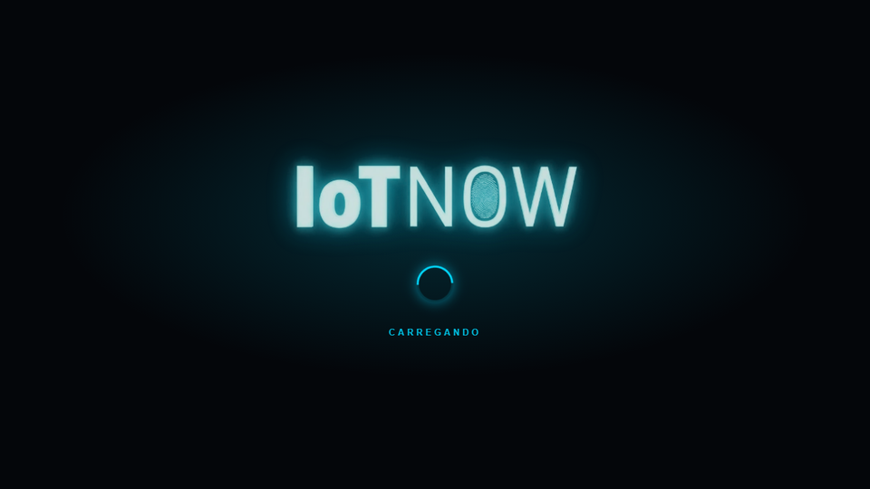
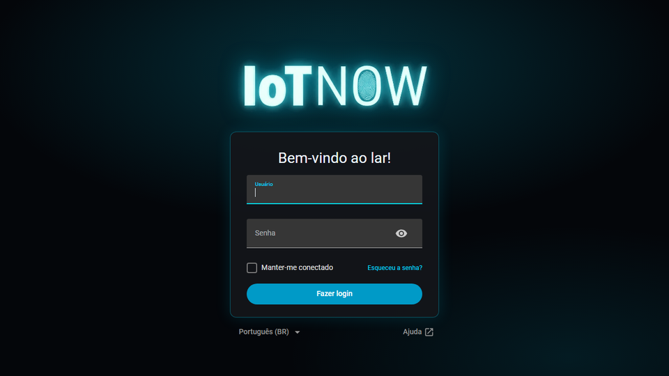
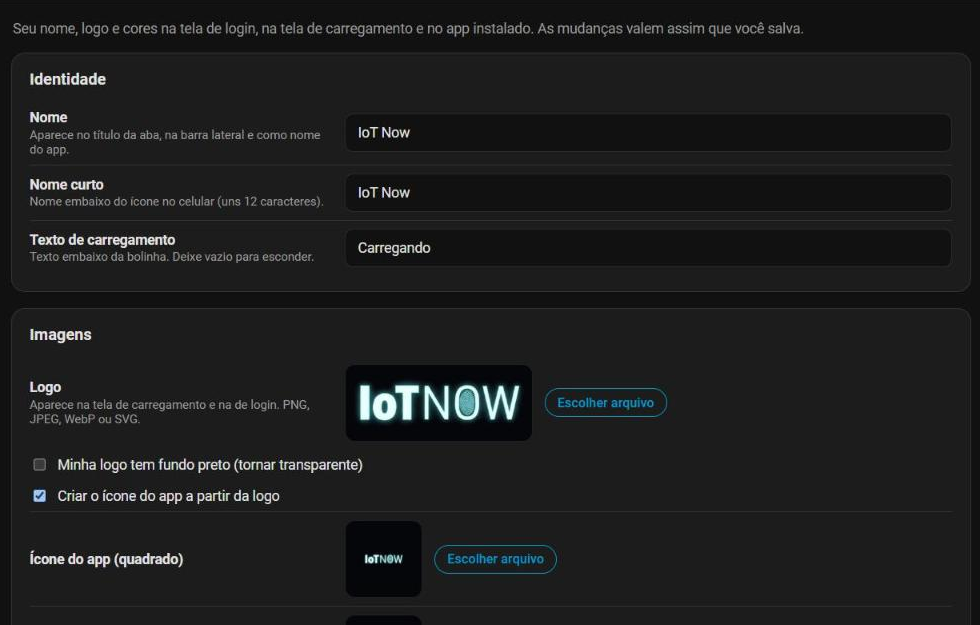
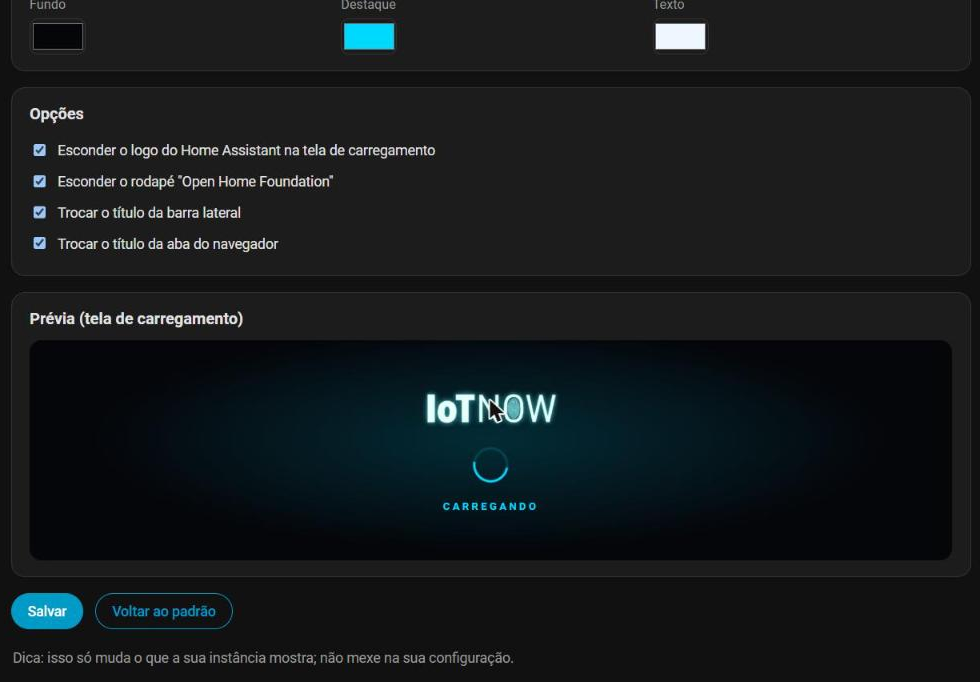

<p align="center"></p>

# Custom Branding for Home Assistant

**Make Home Assistant look like *your* product.** Put your own name, logo and colors on the **login page**, the **loading screen**, the **installed app (PWA)** icon and name, the **sidebar title** and the **browser tab title** — without editing any core file and without a reverse proxy.

> Perfect for installers, integrators, resellers and anyone who gives Home Assistant to a client, a family member or a company and wants it to carry their brand. (🇧🇷 Versão em português logo abaixo.)

| Loading screen | Login page |
| --- | --- |
|  |  |

*(Example brand: IoT Now. The logo, name and colors are all yours to set.)*

### Set it up from a screen — no files, no YAML

A **Branding** panel appears in the sidebar (admins only). Choose your logo, type the name, pick the colors, press **Save**. Changes apply immediately, no restart needed.

| Identity + images | Colors, options + live preview |
| --- | --- |
|  |  |

## What it changes

| Where | What you get |
| --- | --- |
| **Loading screen** (the "Loading…" page after F5) | Your logo, a spinning ring in your accent color, your own text. The Home Assistant logo and the "Open Home Foundation" footer are hidden. |
| **Login page** | Your logo on top instead of the blue Home Assistant icon, your background and accent colors. |
| **Installed app / "Add to Home Screen" (PWA)** | Your app **name** and **icon** (Chrome, Edge, Android, iOS). |
| **Sidebar title** and **browser tab title** | "My Home" instead of "Home Assistant". |

Everything is optional: only the options you set are applied.

## ⚠️ Before you install

* **Make a backup first.** Copy `configuration.yaml` (for example to `configuration.yaml.bak`) and, ideally, create a full backup in *Settings → System → Backups*. Nothing here deletes or changes your data, but you will edit `configuration.yaml` and restart Home Assistant, and a backup makes it a 10-second undo.
* **Tested version:** version 2.0 was tested on **Home Assistant 2026.10.2** (Home Assistant OS). It hooks into the web routes that serve the login page and the loading screen, which are internal parts of Home Assistant's frontend. **Other Home Assistant versions are not guaranteed**: if a future version changes those internals, Custom Branding logs a warning and Home Assistant keeps serving its original pages (nothing breaks), but the branding may stop appearing until this integration is updated. If that happens, please [open an issue](https://github.com/DELACROZ/ha-custom-branding/issues) with your Home Assistant version.
* **If something goes wrong:** delete the `custom_branding:` block from `configuration.yaml` (or restore your backup) and restart.

## Install

### With HACS (custom repository)
1. HACS → ⋮ → **Custom repositories** → add `https://github.com/DELACROZ/ha-custom-branding` as category **Integration**.
2. Download **Custom Branding**, then restart Home Assistant.
3. **Settings → Devices & services → Add integration → Custom Branding.**
4. Open **Branding** in the sidebar and set it up (next section).

### Manual
Copy `custom_components/custom_branding` into your `/config/custom_components/` folder, restart, then add the integration as in step 3 above.

## Configure (from the panel)

Open **Branding** in the sidebar:

* **Identity:** name (tab title, sidebar and app name), short name (under the app icon on the phone), the loading text and the login screen text (replaces "Welcome Home!").
* **Images:** choose your **logo**. Tick *"My logo has a black background"* if it is a JPEG on black (it becomes transparent). Leave *"Create the app icon from the logo"* ticked and the square app icons are made for you; or upload your own. PNG, JPEG, WebP or SVG are accepted (max 6 MB).
* **Colors:** background, accent (spinner, buttons) and text. The preview shows the loading screen live.
* **Options:** hide the Home Assistant logo / the "Open Home Foundation" footer, replace the sidebar title and the tab title.
* Press **Save**, then reload the page with **Ctrl+F5**. Uploaded images are stored in `/config/custom_branding/`.

Best results: a transparent PNG logo (wide logos work best), made for dark backgrounds.

### Upgrading from 1.x (YAML)
If you used the `custom_branding:` block in `configuration.yaml`, it is **imported automatically once** the first time the integration starts. After that you can edit everything in the panel and delete the YAML block. (Images that were referenced by path, like `/local/branding/logo.png`, keep working.)

<details><summary>YAML reference (legacy, imported once)</summary>

```yaml
custom_branding:
  name: "My Smart Home"
  short_name: "Smart Home"
  logo: /local/branding/logo.png
  icon: /local/branding/icon-512.png
  icon_maskable: /local/branding/icon-maskable.png
  background_color: "#0b1220"
  accent_color: "#38bdf8"
  text_color: "#eef7ff"
  loading_text: "Loading"
  welcome_text: "Welcome!"
  hide_ha_logo: true
  hide_open_home_foundation: true
  sidebar_title: true
  tab_title: true
```

</details>

## Good to know

* **Cache:** after changing the settings, restart Home Assistant and reload the page with **Ctrl+F5** (on phones, clear the site data once). The generated files carry a version in their URL, so later changes are picked up automatically.
* **Already installed apps (PWA)** keep their old name/icon: uninstall and install again to get the new ones.
* **Light themes:** the login/loading screens are designed with a dark background. Pick a dark `background_color`.
* **Trademark note:** this only changes what *your* instance shows. Home Assistant and the Home Assistant logo are trademarks of the Open Home Foundation.

## How it works

Home Assistant renders the login page and the loading screen from fixed HTML files that no setting, theme or `extra_module_url` can reach. Custom Branding wraps the two web routes that serve them (`/` and `/auth/authorize`) and adds one `<link>`/`<script>` pair plus a few attribute swaps. Its own generated assets are served from `/custom_branding/` (public, because the login page needs them before anyone is signed in; uploads are admin-only and checked by file signature). Settings live in the integration's config entry and the images in `/config/custom_branding/`. If anything goes wrong, the original page is served untouched and a warning is logged.

It does **not** modify any Home Assistant file and keeps no state. To remove it: delete the integration in *Settings → Devices & services* (and the `custom_branding:` block if you still have it), then restart; you can also delete `/config/custom_branding/`.

## Troubleshooting

* *Nothing changed* → check **Settings → System → Logs** for `custom_branding`. Make sure the YAML key is at the top level and the image paths open in your browser (e.g. `https://your-ha/local/branding/logo.png`).
* *Logo looks too small/large* → use a transparent PNG cropped tight around the artwork.
* *Works on the home page but not the login* → hard-reload the login page; browsers cache it.

## Tests

`python tests/test_assets.py` (no Home Assistant needed) checks the HTML rewriting against real captured pages.

## Credits

Created by **Marcelo Junior ([@DELACROZ](https://github.com/DELACROZ))** · **IoT Now** — smart homes, offices and telemetry in Caldas Novas, Goiás, Brazil.
Born from a real client project and shared with the community. Issues and pull requests are welcome.

🌐 [marceloautomacoesgo.com.br](https://marceloautomacoesgo.com.br) · 📸 [@iot_now_automacoes](https://www.instagram.com/iot_now_automacoes)
Need a custom Home Assistant project, white-label setup or automation consulting? Get in touch through the website.

MIT licensed.

---

# 🇧🇷 Português

**Deixe o Home Assistant com a *sua* marca.** Coloque seu nome, logo e cores na **tela de login**, na **tela de carregamento**, no **ícone e nome do app instalado (PWA)**, no **título da barra lateral** e no **título da aba** — sem mexer em arquivos do sistema e sem proxy reverso.

**Antes de instalar:** faça um **backup do `configuration.yaml`** (copie para `configuration.yaml.bak`) e, de preferência, um backup completo em *Configurações → Sistema → Backups*. **Versão testada:** Home Assistant **2026.10.2** (HA OS). Em outras versões **não há garantia**: se uma versão futura mudar essas partes internas, a integração registra um aviso e o Home Assistant continua mostrando as telas originais (nada quebra), mas a marca pode deixar de aparecer até a integração ser atualizada. Se acontecer, abra uma *issue* informando a sua versão. Para desfazer: apague o bloco `custom_branding:` (ou restaure o backup) e reinicie.

**Instalação (HACS):** HACS → ⋮ → *Repositórios personalizados* → `https://github.com/DELACROZ/ha-custom-branding` → categoria *Integração* → baixar **Custom Branding** → reiniciar.

**Configuração (pela tela):** *Configurações → Dispositivos e serviços → Adicionar integração → Custom Branding*. Depois abra **Branding** no menu lateral: escolha a **logo** (marque a caixa se ela tiver fundo preto), digite o **nome**, escolha as **cores** e clique em **Salvar**. Vale na hora (recarregue com **Ctrl+F5**); não precisa reiniciar nem editar arquivo. O ícone do app é criado a partir da logo. Apps já instalados precisam ser desinstalados e instalados de novo para pegar o ícone novo.

**Vindo da versão 1.x (YAML):** o bloco `custom_branding:` é importado sozinho uma vez; depois você pode apagá-lo e editar tudo na tela.

**Criado por Marcelo Junior ([@DELACROZ](https://github.com/DELACROZ))** · **IoT Now** — casas e escritórios inteligentes e telemetria em Caldas Novas, Goiás. Site: [marceloautomacoesgo.com.br](https://marceloautomacoesgo.com.br) · Instagram: [@iot_now_automacoes](https://www.instagram.com/iot_now_automacoes).
